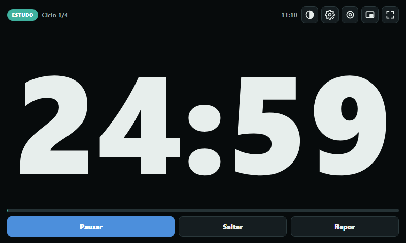
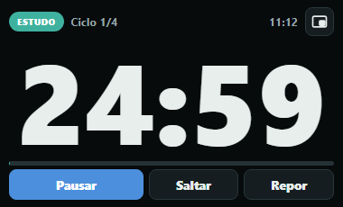
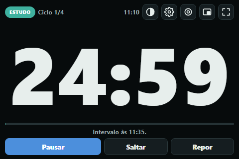
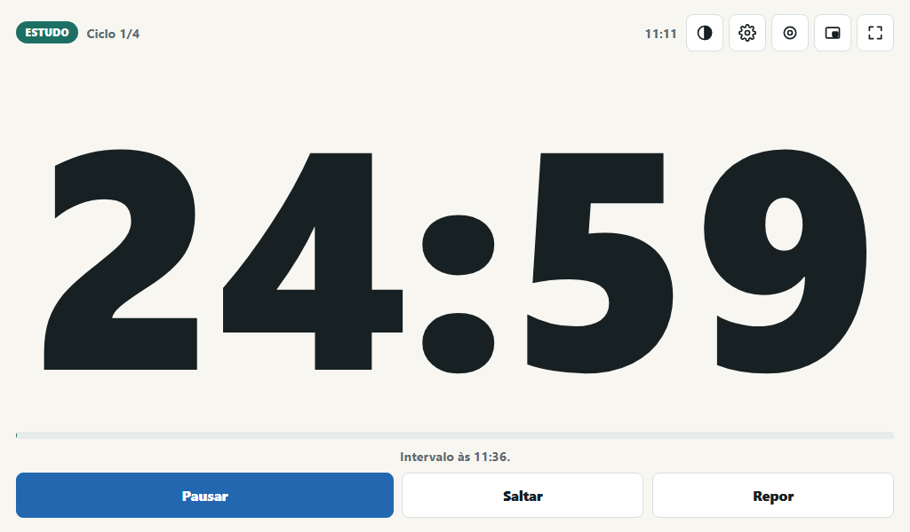
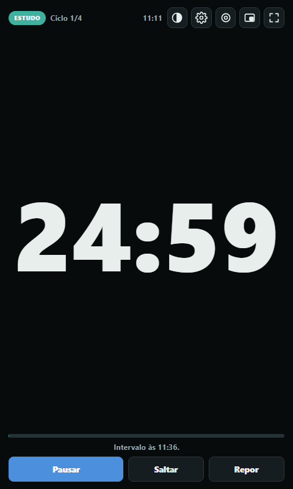
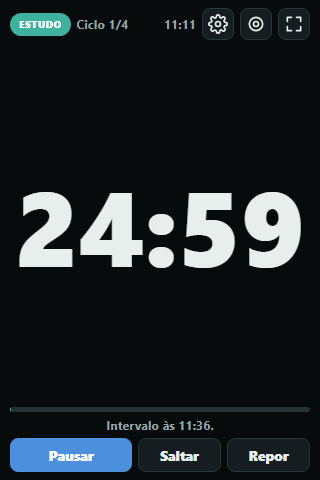
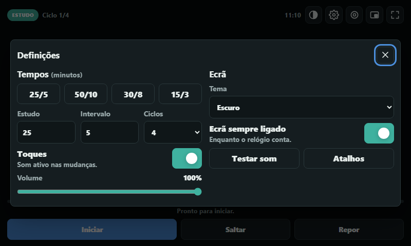
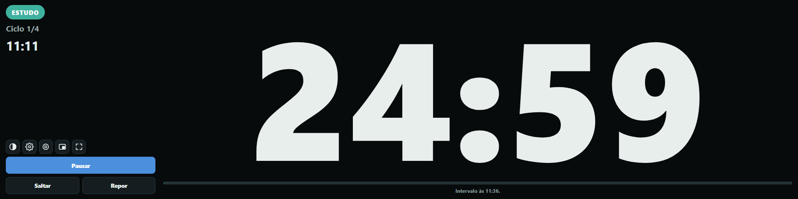
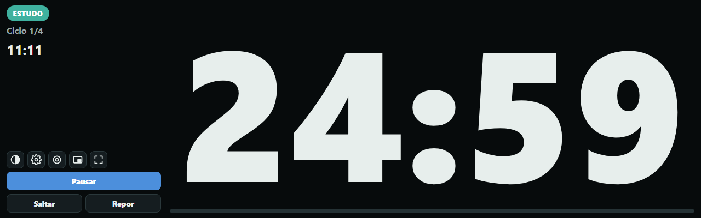
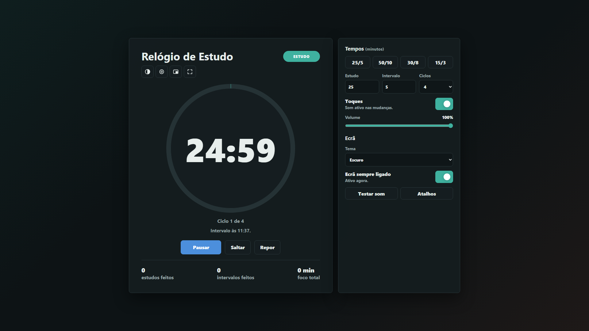

# Relógio de Estudo (Study Clock)

O Relógio de Estudo é uma aplicação simples para organizar sessões de estudo com intervalos. Foi pensado para ficar a contar num **mini monitor** (um ecrã secundário pequeno) ao lado do computador, mas também funciona no portátil e no telemóvel.

**Abrir:** https://yusa172.github.io/Study-clock/

Escolhes quantos minutos queres estudar, quantos minutos de intervalo queres e quantos ciclos queres fazer. Quando uma fase termina, o relógio toca e o ecrã pisca para avisar que está na hora de mudar entre estudo e intervalo.



## Funcionalidades

- Tempo de estudo, tempo de intervalo e número de ciclos à tua escolha, com predefinições (25/5, 50/10, 30/8, 15/3).
- Iniciar, pausar, saltar para a próxima fase e repor a sessão.
- **Números grandes** que ocupam o espaço disponível em qualquer ecrã, de 320x480 até Full HD.
- **Modo foco**: só fica o tempo, a fase e a barra de progresso; os botões desaparecem enquanto o relógio conta e voltam quando mexes no rato.
- **Janela flutuante** (tecla `P`): o relógio sai da página para uma pequena janela que fica sempre por cima das outras, como um vídeo em "Picture-in-Picture". Funciona no Edge e no Chrome no computador.
- **Ecrã inteiro** com um clique ou com a tecla `F`.
- **Tema escuro**, claro ou automático (segue o Windows).
- **O ecrã não se apaga** enquanto o relógio conta ou está em modo foco (em browsers que o permitem: Edge, Chrome, Firefox e Safari recentes).
- **Temporizador fiável em segundo plano**: o tempo é calculado a partir da hora real, por isso não se atrasa se mudares de separador ou minimizares a janela.
- A sessão continua se recarregares a página ou se o browser fechar sem querer.
- Hora atual e hora prevista para o fim da fase ("Intervalo às 15:05").
- Atalhos de teclado.
- **Toque de sino forte e claro**, diferente para cada momento: desce quando começa o intervalo, sobe quando voltas ao estudo e acaba num acorde no fim da sessão. Toca duas vezes para não passar despercebido, e o ecrã pisca ao mesmo tempo.
- Contador de estudos feitos, intervalos feitos e minutos reais de foco.
- As definições ficam guardadas no browser. Não há contas nem dados enviados para lado nenhum.

## Janela flutuante

Carrega no botão da janela flutuante (no canto superior direito) ou na tecla `P`. O relógio passa para uma janela pequena que fica sempre por cima das outras aplicações: podes estudar no Word ou no PDF e continuar a ver o tempo.



- Podes arrastar a janela para qualquer sítio, incluindo para o mini monitor, e mudar o tamanho dela. Os números ajustam-se sozinhos.
- Na janela funcionam as teclas `Espaço`, `S`, `R`, `T` e `P`.
- Para a fechar, carrega no mesmo botão, em `P` ou no X da janela. O relógio volta para a página sem parar de contar.
- Enquanto a janela está aberta, as definições ficam na página original.
- A janela flutuante existe no Edge e no Chrome (versão 116 ou mais recente) no computador. Noutros browsers o botão não aparece.

## Como usar num mini monitor

1. Liga o mini monitor ao computador e, no Windows, escolhe **Definições > Sistema > Ecrã > Expandir estes ecrãs**.
2. Abre https://yusa172.github.io/Study-clock/ no Edge ou no Chrome.
3. Arrasta a janela do browser para o mini monitor.
4. Carrega em `F` (ou no botão de ecrã inteiro, no canto superior direito). O relógio passa a ocupar o mini monitor todo, em modo foco.
5. Carrega em `Espaço` para começar. Para sair do ecrã inteiro, carrega em `Esc` ou outra vez em `F`.

Dicas:

- Mantém a janela do relógio visível. Se a minimizares, o browser deixa de manter o ecrã ligado (o tempo continua certo na mesma).
- Se os botões parecerem muito pequenos ou muito grandes, ajusta a escala do mini monitor em **Definições > Sistema > Ecrã > Escala** (100% costuma ser o melhor para ecrãs de 5 a 7 polegadas).
- No Edge podes instalar o relógio como aplicação (**Definições e mais > Aplicações > Instalar este site como aplicação**). Assim abre numa janela própria, sem separadores, que fica sempre no mini monitor.
- Se quiseres que o relógio abra já em modo foco, usa este endereço: https://yusa172.github.io/Study-clock/?foco

### Atalho para abrir diretamente no mini monitor (opcional)

Podes criar um atalho no Ambiente de Trabalho com este destino. O `--window-position` é a posição do mini monitor: por exemplo, `1920,0` se ele estiver à direita de um ecrã Full HD.

```
"C:\Program Files (x86)\Microsoft\Edge\Application\msedge.exe" --app="https://yusa172.github.io/Study-clock/?foco" --window-position=1920,0 --user-data-dir="%LOCALAPPDATA%\StudyClockEdge"
```

O `--user-data-dir` abre uma instância separada do Edge, para as opções funcionarem mesmo que o Edge já esteja aberto. Depois de abrir, carrega em `F` para ecrã inteiro.

### Tamanhos testados

A janela flutuante foi testada em 240x140, 300x170, 380x230 (o tamanho inicial), 520x300 e 600x150.

O layout foi testado sem barras de scroll e sem elementos cortados nestes tamanhos, com tema escuro e claro, em modo foco e com as definições abertas:

| Ecrã | Resolução |
| --- | --- |
| Mini monitor de 3,5" | 480x320 e 320x480 (retrato) |
| Mini monitor de 5" | 800x480 e 480x800 (retrato) |
| Mini monitor de 7" | 1024x600 e 600x1024 (retrato) |
| Barras ultra-largas | 1280x400 e 1920x480 |
| Telemóvel | 390x844 |
| Portátil e monitor | 1366x650 e 1920x1080 |

Em ecrãs pequenos (até 820 px de largura ou 700 px de altura) o relógio usa automaticamente o layout compacto: números enormes, botões em baixo e as definições num painel que abre com o botão de engrenagem ou com a tecla `D`. Em barras muito largas, os controlos passam para a esquerda e os números ficam com o resto do ecrã.

| 480x320 | 1024x600 (tema claro) |
| --- | --- |
|  |  |

| 480x800 (retrato) | 320x480 (retrato) | Definições em 800x480 |
| --- | --- | --- |
|  |  |  |

Barra de 1920x480:



Barra de 1280x400 em modo foco:



Monitor normal (1920x1080), com as definições ao lado:



## Atalhos de teclado

| Tecla | Ação |
| --- | --- |
| `Espaço` | Iniciar ou pausar |
| `S` | Saltar para a próxima fase |
| `R` | Repor a sessão |
| `P` | Janela flutuante, sempre por cima |
| `F` | Ecrã inteiro (entra em modo foco) |
| `M` | Modo foco, sem distrações |
| `T` | Mudar tema: automático, escuro, claro |
| `D` | Abrir ou fechar as definições |
| `?` | Mostrar os atalhos |
| `Esc` | Fechar painéis |

## Notas

- O volume vai de 10% a 100%. Os 100% são o máximo que as colunas aguentam sem o som distorcer (o toque antigo correspondia a cerca de 20%).
- Os browsers só deixam tocar som depois de clicares ou carregares numa tecla na página. Se recarregares a página com o relógio a contar, clica uma vez no relógio para voltar a ter som.
- Se o computador entrar em suspensão a meio de uma sessão, o relógio acerta o tempo quando voltar, tal como um temporizador de telemóvel.
- A aplicação é um único ficheiro (`index.html`), sem dependências. Também funciona sem internet: descarrega o repositório e abre o `index.html`.

## Estrutura

- `index.html`: aplicação completa (HTML, CSS e JavaScript).
- `site.webmanifest`, `icon.svg`, `icon-192.png`, `icon-512.png`: dados e ícones para instalar como aplicação.
- `404.html`: redirecionamento simples para a página principal.
- `docs/screenshots/`: capturas de ecrã dos testes nos vários tamanhos.
